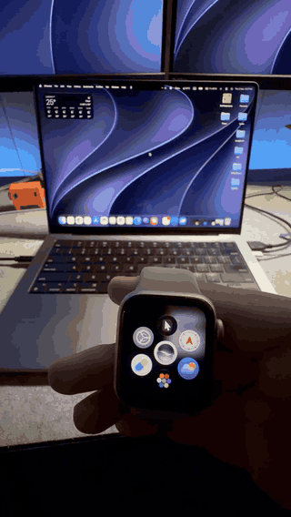

# WatchPointer


Use your Apple Watch as a pointer for your Mac. Point it at the screen to move the cursor, tap to click, hold to drag.

No Wi-Fi, no servers: the watch talks straight to the Mac over Bluetooth.

<p align="center">
  
</p>

## What it does

- **Point** like a laser pointer: the cursor goes where the top edge of the watch points. Works across all your displays.
- **Tap** the pad to click, **hold** to drag, **right-click** button, **Digital Crown** to scroll.
- **Center** re-aims the middle of the screen; **Pause** frees the cursor for your trackpad.
- **Pair** with a Mac once; the watch only connects to that Mac until you unpair it.
- **Notch panel** on the Mac: connection state, the watch's name and model, battery, live aim, and a pin to keep it open.
- **Sky Shot**, a small light-gun style game to try it on.

## Requirements

- Mac with macOS 14 or later and Bluetooth
- Apple Watch with watchOS 11 or later
- Xcode 16 or later (to install the watch app)

## Run it

### 1. Mac receiver

```bash
cd Mac
swift run WatchPointer
```

The first time, macOS asks for **Bluetooth** access and for **Accessibility** access (System Settings › Privacy & Security › Accessibility) for your terminal app. Accessibility is what lets it move the cursor. Allow both, then run it again.

It shows up in the notch (or the middle of the menu bar on Macs without one).

### 2. Watch app

1. Open `Watch/WatchPointer.xcodeproj` in Xcode.
2. In **Signing & Capabilities**, pick your team. If Xcode complains about the bundle identifier, change it to something of your own.
3. Choose your Apple Watch as the run destination and press **⌘R**.
4. Open WatchPointer on the watch and tap **Pair** next to your Mac.

### 3. Point

Hold the watch like a remote with the top edge (12 o'clock) toward the screen. Point at the middle of the screen and tap **Center** to line it up.

## Settings

All on the Mac, no reinstall needed:

```bash
swift run WatchPointer 1.2               # speed: higher = less turn to reach the edges
swift run WatchPointer steady=0.6        # steadier when holding still (default 0.8)
swift run WatchPointer quick=0.02        # less lag on fast moves (default 0.01)
```

## Sky Shot

Open `Game/index.html` in a browser, press **F** for full screen, and tap the watch to start. Paper planes fly across a sky that turns from morning to sunset as the round runs out. Bullseyes count double, gold planes triple.

## Tips for using it in your hand

On the iPhone's Watch app, turn off **Passcode › Wrist Detection**, or the watch locks as soon as it's off your wrist. On the watch, set **Display & Brightness › Wake Duration** to 70 seconds and **General › Return to Clock › WatchPointer** to one hour.

## How it works

- **Watch** (`Watch/`): reads gravity and the gyroscope 100 times a second. Up/down comes from gravity, so it never drifts; left/right adds up turns around the vertical. Each sample is sent with the watch's timestamp.
- **Mac** (`Mac/`): projects the aim onto the screen like a laser hitting a wall, smooths it with a [1€ filter](https://gery.casiez.net/1euro/) using the watch's timestamps, and moves the cursor 240 times a second on its own thread. Clicks land where you were pointing the moment your thumb touched the watch, so the tap's jolt doesn't move them.
- **Bluetooth**: the Mac advertises a service; the watch connects and writes small packets (aim, click, drag, scroll, pause, info). The protocol is documented at the top of `Mac/Sources/WatchPointer/Receiver.swift`.

## Security note

Pairing is chosen on the watch. The Mac itself doesn't ask for confirmation yet, so any nearby Bluetooth device that speaks this protocol could move the cursor while the receiver is running. Quit the receiver when you're not using it.

## License

MIT, see [LICENSE](LICENSE).
